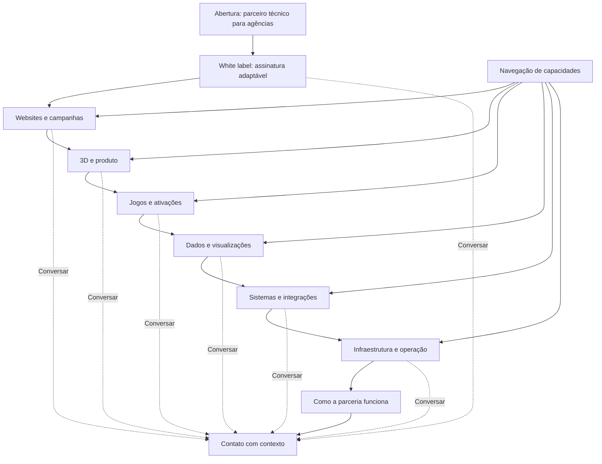

# Arquitetura da informação

## Jornada e profundidade

A home mantém uma narrativa única, com navegação por capítulos e espaço para explorar cada demo. O visitante deve entender a proposta sem completar um jogo ou abrir todos os detalhes.

Três níveis de leitura:

- **Reconhecer:** título, uma frase comercial e estado inicial da experiência.
- **Experimentar:** uma ação clara com resposta imediata; controles essenciais sempre visíveis.
- **Aprofundar:** expandir o capítulo para mais controles, detalhes técnicos e aplicações, mantendo a posição na página.

As experiências não bloqueiam a navegação. Não exigir login, formulário, áudio, pontuação mínima ou conclusão de percurso para chegar ao contato.

## Navegação

Barra discreta com marca, Capacidades, White label, Como trabalhamos, Contato e PT/EN. “Capacidades” abre uma lista curta dos seis serviços. Em telas pequenas, menu acessível; acesso ao idioma e contato continua fácil.

Depois da abertura, uma régua compacta de capítulos pode indicar a seção atual. A régua não deve competir com o palco da demo. O rodapé repete os links essenciais e o canal de contato.

| Seção | ID estável | Rótulo PT | Rótulo EN |
| --- | --- | --- | --- |
| S01 | `inicio` | Início | Home |
| S02 | `whitelabel` | White label | White label |
| S03 | `websites` | Websites | Websites |
| S04 | `experiencias-3d` | Experiências 3D | 3D experiences |
| S05 | `jogos` | Jogos | Games |
| S06 | `dados` | Dados | Data |
| S07 | `sistemas` | Sistemas | Systems |
| S08 | `infraestrutura` | Infraestrutura | Infrastructure |
| S09 | `parceria` | Como trabalhamos | How we work |
| S10 | `contato` | Contato | Contact |

Manter os mesmos IDs nos dois idiomas simplifica troca de idioma com preservação da seção. Exemplos de acesso direto: `/#dados` e `/en/#dados`. A abertura por hash deve funcionar mesmo antes da demo carregar, reservando espaço para evitar saltos.

## URLs e escopo de páginas

Na primeira V2, preservar `/` em português e `/en/` em inglês. Expandir demonstrações dentro da home, sem introduzir seis rotas incompletas. O idioma alterna texto, controles, mensagens, tooltips, descrições acessíveis, números e metadados, preservando estado da sessão.

O atual esquema de `pushState` pode continuar com uma camada pequena para idioma e âncoras. Histórico de voltar/avançar precisa ser tratado. A expansão de uma demo não cria uma nova página indexável; usar links por seção para compartilhamento.

Páginas individuais de serviço ou laboratório podem vir depois de existirem conteúdo e procura que justifiquem manutenção editorial. Nessa fase posterior, definir canonical, sitemap, navegação de retorno e comportamento de refresh por rota.

## Conteúdo comercial inicial PT/EN

Rascunho para direção, não texto final aprovado. O tom é direto, técnico quando necessário e próprio de uma operação estruturada, com liderança identificável.

| Seção | Título PT | Título EN | Mensagem que precisa acompanhar |
| --- | --- | --- | --- |
| S01 | A operação técnica por trás da sua agência. | The technical operation behind your agency. | Equipe própria de desenvolvimento e TI, com liderança técnica integrada à agência |
| S02 | Uma frente técnica. Uma equipe por trás. | One technical point of contact. A team behind it. | Mário representa a operação sob a identidade da agência |
| S03 | Do layout aprovado à experiência no ar. | From approved design to a live experience. | Responsividade, fidelidade, conteúdo e interação |
| S04 | Dê ao produto uma experiência própria. | Give your product an experience of its own. | Configuração, detalhes, materiais e narrativa de produto |
| S05 | Uma campanha que dá vontade de jogar. | A campaign people want to play. | Mecânica curta, feedback e identidade de marca |
| S06 | Dados que respondem às suas perguntas. | Data that responds to your questions. | Exploração coordenada e compreensão de informações |
| S07 | A interface é só o começo. | The interface is only the beginning. | Regras, integrações, falhas e recuperação |
| S08 | Do escritório à cloud, tudo conectado. | From the office to the cloud, connected. | Equipamentos, dependências, continuidade e manutenção |
| S09 | Do briefing à continuidade. | From the brief to ongoing support. | Entrada pelo time da agência e entregas claras |
| S10 | Vamos falar do próximo projeto. | Let’s talk about your next project. | Conversa no LinkedIn com contexto útil |

Exemplo de apoio do hero:

**PT:** “Uma equipe própria de desenvolvimento e TI nos bastidores. Uma liderança técnica integrada às suas reuniões, decisões e entregas. Tudo sob a marca da sua agência.”

**EN:** “Our own development and IT team behind the scenes. A technical lead embedded in your meetings, decisions and delivery. All under your agency’s brand.”

CTA principal do hero: “Explorar capacidades / Explore capabilities”. Secundário: “Falar de um projeto / Discuss a project”. Cada demo usa um CTA contextual para `#contato`, como “Quero isso em uma campanha / I need this for a campaign”.

## Conteúdo por capítulo

Cada serviço contém: contexto de uso, experiência, instrução curta, três exemplos de entregas, detalhes técnicos expansíveis e CTA contextual. A ordem e a disposição variam para evitar repetição visual.

Exemplos de entregas:

| Capacidade | Aplicações para agências |
| --- | --- |
| Websites | Landing pages, sites institucionais, campanhas e conteúdo editorial |
| 3D | Configuradores, apresentação de produto, showrooms digitais |
| Jogos | Ativações, campanhas promocionais, experiências de marca |
| Dados | Relatórios interativos, dashboards, narrativas editoriais com dados |
| Sistemas | Portais, fluxos de aprovação, integrações e automações |
| Infraestrutura | Redes, publicação, backups, containers, cloud e acompanhamento operacional |

As aplicações não são promessas de projetos anteriores. Demos exibem “Demonstração autoral / Original demo”; dados e eventos usam “Dados simulados / Simulated data”.

## Conversão e prova

O contato atual por LinkedIn permanece. O CTA de um serviço marca esse interesse no resumo de conversa, sem enviar dados. O visitante pode copiar um texto curto e abrir o perfil existente. Não prometer preenchimento automático de mensagem no LinkedIn.

A configuração da assinatura pode alimentar o resumo de interesse somente dentro da sessão. Alterar estilo visual não significa consentir em envio de informação. Sem backend de leads nesta versão.

Credibilidade vem de comportamento demonstrável, equipe própria confirmada e liderança identificável. Apresentar Mário como responsável pela interlocução e coordenação, sem expor a identidade dos profissionais operacionais. A seção de parceria explica como as frentes se organizam para múltiplos projetos; não promete capacidade ilimitada. Se o operador fornecer casos autorizados, incluir contexto, papel e resultados verificáveis em uma etapa própria.

## Ritmo e acessibilidade

Scroll natural; capítulos com alturas variáveis; pausas visuais entre cenas densas. Sticky pode ser usado pontualmente em desktop, sem obrigar percurso por scroll nem impedir leitura em viewport baixa.

Cada demo tem instrução, pausa quando necessária e reset. No mobile, controles abaixo ou antes do palco, sem depender de hover. Todas as capacidades permanecem explicáveis no modo de pouco movimento ou sem WebGL. O encerramento autoral pode manter a personalidade da V1 sem competir com o contato.
